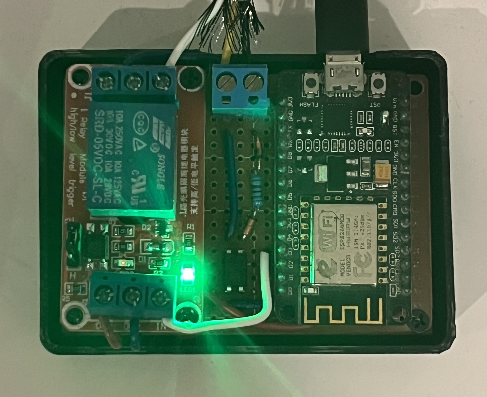

# RemoteIntercom

<p align="center">
  
</p>

RemoteIntercom runs on an ESP8266 and provides a network-controlled door
release and doorbell notifications. See the [circuit documentation](circuit/README.md)
for the hardware interface.

## Installation and setup

Prerequisites: an ESP8266 board, `esptool`, `mpremote`, `mpy-cross`, and `just`.
The development shell provides the required tools.

Erase existing firmware and files:
```bash
esptool --chip esp8266 erase-flash
```

Flash MicroPython (replace filename as needed):
```bash
esptool --chip esp8266 --baud 115200 \
  write-flash \
  --flash-mode dout \
  --flash-size detect \
  0x0 firmware/ESP8266_GENERIC-*.bin
```

Deploy the application with `just copy`, then run `just reset`. This compiles
the library modules with `mpy-cross` on the development machine and copies the
small `main.py` plus the HTML pages. Repeat both commands after changes.

On a new device, join the open `RemoteIntercomXXXX` network (the four digits
come from the ESP's MAC address), then browse to `http://192.168.4.1/`.
Log in with the initial password `admin`. The setup page requires a new
administrator password before it saves the home Wi-Fi credentials. A connection
page waits for the result. On success, it shows a final confirmation, then turns
off the provisioning AP after five seconds. If the browser leaves before that
confirmation, the AP turns off within 60 seconds of a successful connection.
Reloading the confirmation never extends that deadline.
On failure, it opens the admin page with the saved SSID ready to edit.

## Security

The provisioning access point is open and the web server uses plain HTTP.
Passwords submitted during setup, login or settings changes, and session cookies,
can be read by someone capturing the traffic. Anyone who can reach the configured
device can open the door. See the [security design notes](docs/design.md#provisioning-security-limitation).

## Documentation

- [Intercom interface and API](docs/intercom-api.md): wiring, GPIO behavior, door release and doorbell notifications.
- [Operation and troubleshooting](docs/operation.md): Wi-Fi and password recovery, and serial diagnostics.
- [Simulator](docs/simulator.md): running tests and interactive sessions, and their limitations.
- [Design notes](docs/design.md): provisioning security and request scheduling.
- [Circuit](circuit/README.md): circuit design and intercom measurements.
